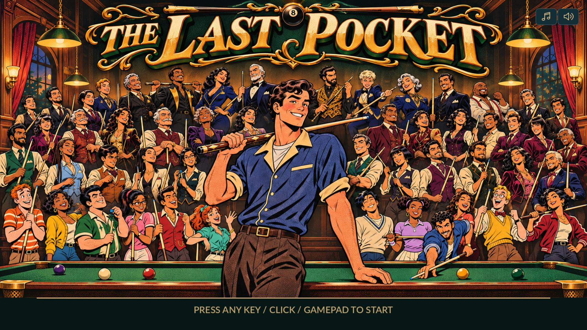

# The Last Pocket

A Linux cue-sports game with local two-player matches, AI rivals and a 48-rival comic-style championship.



[Gameplay preview](docs/current-build.png) · [Rival introduction](docs/rival-card.png) · [Manual saves](docs/manual-save-slots.png) · [Rival result](docs/rival-result.png) · [Champion ending](docs/champion-ending.png) · [Global board preview](docs/global-scoreboard-preview.png)

## Play

Download the Linux archive from [GitHub Releases](https://github.com/quietbytehq/the-last-pocket/releases), extract it, then run `TheLastPocket/play.sh`. Godot is not required to play the exported build. The launcher selects native Wayland on Wayland desktops and otherwise uses the normal Linux display driver.

The game starts fullscreen with a group portrait of the hero and his rivals beneath an ornate gold title. Press any key, then choose **Local Versus** or **Versus AI**. Local Versus offers ten modes. Versus AI offers nine competitive game types as championships: new runs always start in Amateur, and rivals are revealed one at a time. For a local match, choose a game, enter two names and select **Play Match**. In Local Versus, both players share the mouse and keyboard. In Versus AI, you are player one. Tournament progress is saved only when you choose **Save tournament**. The separate save menu has ten slots with the player name and local date/time. Use **Load tournament** to open a chosen save; active frames load paused until you choose **Resume play**. There is no automatic progress saving.

## Championship

Four ranks — Amateur, Professional, Master and GOAT — each introduce twelve original comic-style opponents. Win frames to unlock upgraded tables and cues. Three retry diamonds allow rematches after a loss. Your journey shows only current and encountered rivals; future opponents stay hidden. Each rival has separate victory and defeat portraits and an individual line for each result. These lines are readable on screen; recorded voices are optional. The local top ten keep each player’s best tournament run. Defeating the final rival opens a personalized trophy presentation with the World Champion title and all 48 rivals defeated. See [TOURNAMENT.md](TOURNAMENT.md) for scoring, progression and AI behaviour.

## Games

- 8-ball pool
- 9-ball pool
- 10-ball pool
- Straight pool, first to 25
- Blackball, with red/yellow sets
- Full 15-red snooker
- Six-red snooker
- Straight-rail carom, first to 10
- Three-cushion carom, first to 5
- Free practice

These are playable club-rule implementations. See [RULES.md](RULES.md) for the implemented rules and the tournament exceptions that are not simulated.

## Controls

| Action | Control |
| --- | --- |
| Aim | Mouse; Left/Right or A/D; gamepad left stick |
| Shoot | Click again after locking aim; Space / Enter; gamepad A; or Shoot button |
| Unlock aim | Right click the table |
| Shot power | Mouse wheel; or drag the left power meter; releasing does not shoot |
| Cue spin | Drag the white spin control at the lower right |
| Reset spin | Right click the white spin control |
| Place cue ball | Left click a clear legal position when ball in hand |
| Called pocket | Keys 1–6, or click a numbered pocket marker. Required before the final 8-ball shot. |
| Called ball / nominated colour | Selector at the bottom |
| Help | H |
| Pause | Escape |
| Fullscreen/window | F11 |
| Effects on/off | M |
| Music on/off | N |
| FPS display | F3 |

For snooker, cue-ball placement is restricted to the D. A coral ring indicates an invalid placement; the cue ball stays white. Pool opening breaks start behind the head string.


## Mouse, keyboard and gamepad

Mouse: move to aim, click the cloth once to lock direction, then click again to fire. Right-click unlocks; the wheel or left meter sets power. Clicking during ball in hand only places the cue ball. The on-screen Shoot button also fires.

Keyboard: Left/Right or A/D rotates aim; Up/Down or W/S sets power. Hold Shift for fine aim or slower placement. During ball in hand, arrows/WASD move the cue ball and Space/Enter places it. Press Space/Enter again to shoot. I/J/K/L adjusts spin; R resets it. Q/E cycles pockets, or use 1–6; C cycles called balls or snooker colours. Tab/arrows navigate menus and Enter chooses.

Gamepad (standard mapped layout): left stick aims or moves the cue ball; A places or shoots. Triggers or D-pad Up/Down adjust power; D-pad Left/Right fine-tunes aim. Right stick sets spin; Y resets it. LB/RB cycles pockets; X cycles called balls/colours. Start pauses/resumes. B pauses at the table or goes back in menus. D-pad/left stick navigates menus; A chooses. Controller disconnection pauses play. Xbox-labelled controls correspond to the standard mapped positions on other controllers.

Gameplay inputs work only on the human turn and do not change the paused table. Moving the mouse or using keyboard/gamepad controls switches the active input hints. No controller is required to play.

For the Snap build, enable controller access once:

```sh
sudo snap connect the-last-pocket:joystick
```

The package declares only the game-controller input interface; it does not request general raw-input access. See [Snap controller access](https://snapcraft.io/docs/reference/interfaces/joystick-interface/).


## Graphics and performance

The revised pocketed tables use a detailed rendered club-table background based on the approved visual reference, combined with live 3D rolling balls, softbox highlights, contact shadows, cue and aiming guide. Pocket drops use a masked descent behind the pocket lip. Player ball sets have large glossy badges beside the names. The dotted aiming guide has a travelling highlight, fades with distance, and freezes when paused. The cue preview stays white; a separate ring indicates placement legality. The overhead view is fixed to preserve alignment. Pool ball/table proportions follow the larger balls in the reference. Carom currently retains the earlier 3D table layout.

Pocketed-table graphics render at the display's native resolution: edge smoothing in Performance, 4×MSAA in High. The earlier fallback carom scene uses reduced 3D resolution in Performance. Interface text remains native.

The frame limiter targets 60 fps. VSync is disabled because testing found a pacing problem in the laptop's Wayland session. See QA_REPORT.md for measurements and scope. Native Wayland on x86-64 Linux with OpenGL 3.3-compatible graphics was tested; other Linux machines and drivers need verification. ARM and Windows builds are not included.

## Audio

Four original stereo impact placeholders are included. The music design is calm hotel-lobby lounge music with separate loops per rank. The bundled stereo lounge track is included as music.mp3. Additional themes, final effects and voices remain optional exports. For the exported game, drop MP3 replacements into its `audio` folder and restart; no rebuild is needed. For source development, use `assets/audio`. OGG/WAV imports require rebuilding. MP3 takes priority over the bundled effects. See [AUDIO_BRIEF.md](AUDIO_BRIEF.md) for filenames, triggers and generation prompts. Effects pan subtly across the table.

## Development

Open `project.godot` with Godot 4.7.2. The project uses the Compatibility renderer. Scripts, rules, physics and scene construction are separate under `scripts/`.

```sh
godot --path .
godot --headless --path . --script tests/test_rules.gd
godot --headless --path . --script tests/test_extended_rules.gd
godot --headless --path . --script tests/test_integration.gd
godot --headless --path . --script tests/test_campaign.gd
godot --headless --path . --script tests/test_campaign_flow.gd
godot --headless --path . --script tests/test_ai.gd
godot --headless --path . --script tests/test_contact_accuracy.gd
```

The exported game has its own compiled smoke test (release executables do not accept editor `--script` commands):

```sh
./build/TheLastPocket/play.sh --audio-driver Dummy -- --self-test
```

For development tests, use an isolated `XDG_DATA_HOME` to keep test files separate from player data. `tools/build-linux.sh` exports and packages the Linux game using installed matching Godot export templates.

The game plays offline. There are no accounts, telemetry or in-app purchases. The optional global top 100 sends only a chosen public name, championship points, run category and game version after explicit confirmation. F2, gamepad X or the privacy button chooses local-only and remembers it. The entry threshold is 1,000 points; local-versus modes are excluded. Scores and champion claims are self-reported, not verified; fake submissions remain possible. The [global scoreboard](https://lastpocket.quietbytehq.uk) is live. See [leaderboard setup](leaderboard/README.md). AI planning runs locally on a background thread. Preferences, the local Top Ten and explicitly selected tournament saves are stored in Godot's `user://` directory. Unselected tournament progress is never saved. Legacy automatic match saves are ignored and left untouched.

## Licence and contact

Source code and original project visual/effect assets: [Apache-2.0](LICENSE). Fonts retain their original licences. Bundled music is distributed with permission for use within this game and is excluded from Apache-2.0. See [NOTICE](NOTICE), [LICENSES](LICENSES) and [ART_PROMPTS.md](ART_PROMPTS.md).

QuietByte · hello@quietbytehq.uk

## Snap packaging

Run `tools/build-snap.sh` with Snapcraft and an initialized LXD builder. The recipe uses core24, strict confinement, the GNOME graphics extension and audio-playback. Save data stays in the snap's per-user common data directory across refreshes.

The complete bundled game is listed as Proprietary in store metadata because the music is licensed for distribution within the game, without separate reuse rights. The source code remains Apache-2.0. Font and engine terms are in NOTICE.

To run the complete headless source suite: `tools/test.sh`. The script isolates test save/settings files from player data.

Version 0.7.1 adds the AI game-type grid. Select a competitive game, enter your name and start the Amateur tour; no rank or opponent selection is needed. Practice is disabled in AI because it is free play without an opponent. Saved tournaments remember their game; older 8-ball saves still load as 8-ball. Local records and save rows show the game type. The existing online board remains 8-ball only; other championship types do not post to that board.

Version 0.7.2 standardises ball size, cloth dimensions and camera framing across all ten game types. Snooker racks and colour spots are spaced for the larger arcade balls; rules and markings remain mode-specific. Carom and three-cushion use matching pocketless artwork at all four tournament ranks. Existing saves keep their original frame geometry until the next frame starts, including AI planning and re-saving.

Windows x86-64 downloads are also available for 0.7.2. Extract the ZIP and open `TheLastPocket.exe`; no Godot installation is needed. Requires Windows 10/11 and OpenGL 3.3-compatible graphics. Build with `tools/build-windows.sh` after installing the Windows export templates. See `tools/README-windows.md` for controls and media terms.
